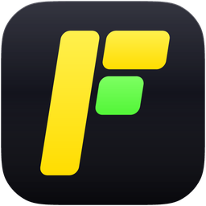
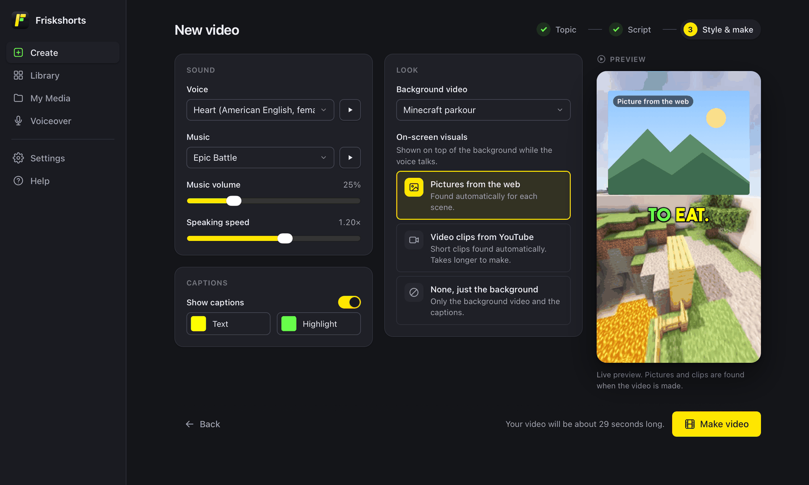
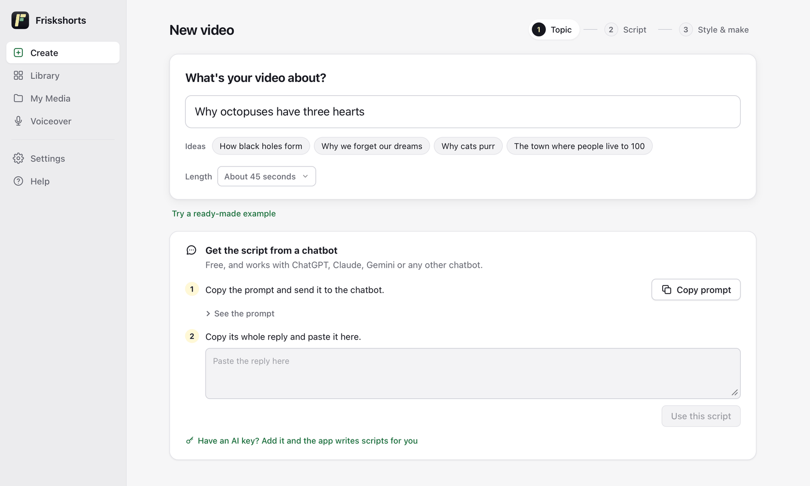
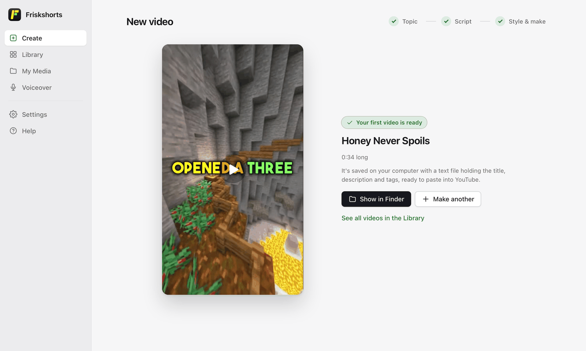

# Friskshorts

Turn a topic into a ready-to-upload YouTube Short, on your own computer.

Free to download. Source is not public.

 

  

## What it does

- **Writes the script.** Use your own AI key (Claude, OpenAI, Gemini, DeepSeek or OpenRouter), or skip the key: copy a ready prompt into any chatbot and paste the reply back.
- **Reads it aloud, offline.** Natural voiceover from 40+ built-in voices, generated on your computer.
- **Sets the scene.** Minecraft parkour, ASMR or your own video in the background, with pictures from the web, YouTube clips or nothing on top.
- **Adds captions.** Word-by-word captions in your colours, with a live preview while you style them.
- **Adds music.** Three public-domain tracks built in, or bring your own.
- **Exports for upload.** A 1080x1920 MP4 plus a text file with the title, description and tags.

<table>
  <tr>
    <td width="50%"></td>
    <td width="50%"></td>
  </tr>
  <tr>
    <td align="center">1. Start with a topic</td>
    <td align="center">3. Your Short is ready</td>
  </tr>
</table>

## Install

The app is not code-signed yet, so your system shows a warning the first time. This is expected.

**macOS (Apple Silicon)**

1. Download the [`.dmg`](https://github.com/backpropghost/Friskshorts/releases/download/v2.1.2/Friskshorts-2.1.2-macos-arm64.dmg) and open it.
2. Drag **Friskshorts** into **Applications**.
3. Open Friskshorts. macOS says it can't check the app for malicious software; click **Done**.
4. Go to **System Settings → Privacy & Security**, scroll down and click **Open Anyway**, then confirm. You only do this once.

**Windows 10 / 11**

1. Download the [setup `.exe`](https://github.com/backpropghost/Friskshorts/releases/download/v2.1.2/Friskshorts-2.1.2-windows-x64-setup.exe) and run it.
2. If SmartScreen says "Windows protected your PC", click **More info → Run anyway**.
3. Installs for your user only. No admin rights needed. Start it from the Start menu.

## Requirements

- A Mac with Apple Silicon (M1 or newer), or Windows 10 / 11 (64-bit)
- About 1 GB of free disk space
- Internet only for AI scripts and web pictures or clips. Voice, captions and rendering work offline.

## Your data

- **API keys** are stored in your system keychain (macOS Keychain, Windows Credential Manager), never in plain files.
- **Videos stay on your computer.** They are saved locally and never uploaded.
- **AI requests go straight to the provider you choose.** There is no Friskshorts server in between.

## Voice cloning (optional)

Want the narration in your own voice? Open **Settings → Voice cloning** and the app downloads and installs the add-on for you (about 1.4 GB). Then add a 10 to 30 second recording under **My Media → Voices**.
There is no need to download anything from the [add-on release](https://github.com/backpropghost/Friskshorts/releases/tag/friskshorts-voiceclone) yourself.

## Licences

Friskshorts includes ffmpeg and espeak-ng (GPL) among other open-source components. Their licences ship inside the app in `THIRD_PARTY_LICENSES`.

## Contact

Found a bug or have a question? [Open an issue](https://github.com/backpropghost/Friskshorts/issues).
